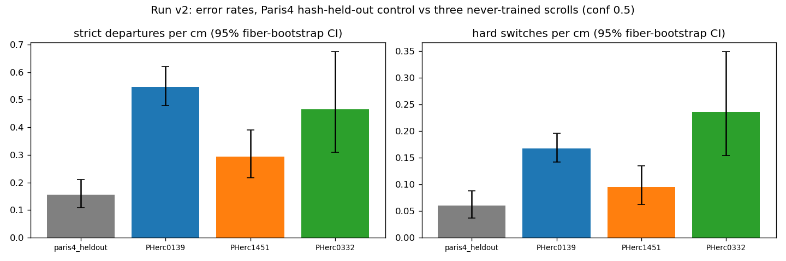
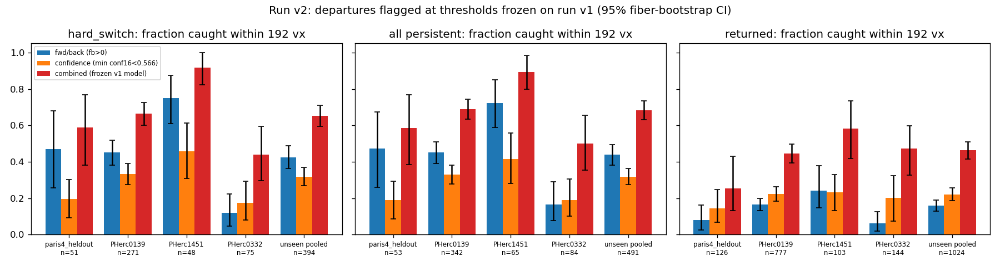

# fiber_single_small on three unseen scrolls: about 3× more departures, and a fwd/back check flags more fiber switches than confidence

The release notes for `scrollprize/fiber_single_small` (12 Oct 2026) say the model *"does make mistakes (though they
are relatively rare), and there is not currently an 'easy' way to tell when it does"*, and that with *"fwd/back
consistency [it] can trace almost entirely mistake free."*

I measured both on three scrolls the model never saw in training: PHerc0139, PHerc1451 and PHerc0332. A held-out
Paris4 set is the comparison.

- **Departures.** On the three scrolls, departures from the fiber per cm are **3.05×** the Paris4 rate (95% CI
  2.2–4.5).
- **Detection.** A simple forward/backward check flagged **42%** of fiber switches, against **32%** for the model's
  confidence (paired p < 0.001), with about 4× fewer false alarms. It did not help on PHerc0332.

> **Author's note** — _TODO (to be written by the author, in their own words, before publishing)._

How it was done:

- **Traces.** 3,248 traces cover every annotated fiber of the three scrolls plus 62 Paris4 fibers, seeded at 2–4
  positions per fiber in both directions.
- **Settings.** The checkpoint ran at confidence 0.5, villa's CLI default for this model, and was scored with villa's
  own scorer.
- **Pre-registration.** The analysis plan (`ANALYSIS_PLAN_v2.md`) and the detector thresholds were fixed on a smaller
  pilot run. Their sha256 was recorded (`results/v2/plan_hash.txt`) before the main run started.
- **Checks.** All numbers were re-run and checked against villa's code and against a second, independent
  implementation (`results/verification/VERIFICATION.md`).

Brackets are 95% CIs from a bootstrap that resamples whole fibers.

## Results

### 1. Error rates are higher on the unseen scrolls

| conf 0.5 | Paris4 (held out) | PHerc0139 | PHerc1451 | PHerc0332 |
|---|---|---|---|---|
| traces / fibers | 496 / 62 | 1608 / 402 | 576 / 72 | 568 / 71 |
| strict length precision (villa) | 0.80 [0.73, 0.86] | 0.58 [0.54, 0.62] | 0.78 [0.71, 0.84] | 0.59 [0.47, 0.71] |
| pointwise length precision | 0.92 | 0.77 | 0.87 | 0.72 |
| length-weighted coverage | 0.38 | 0.25 | 0.22 | 0.33 |
| departures per cm of correct tracing | 0.155 [0.11, 0.21] | 0.55 [0.48, 0.62] | 0.29 [0.22, 0.39] | 0.47 [0.31, 0.67] |
| departures per 100 decisions | 0.20 | 0.64 | 0.40 | 0.31 |
| hard switches per cm | 0.060 | 0.168 | 0.095 | 0.237 |

- **Departures.** On the three scrolls pooled, departures per cm are **3.05×** the Paris4 rate (fiber bootstrap
  [2.17, 4.46]; exact test p < 1e-4). Each scroll is higher on its own: 3.5×, 1.9× and 3.0×, all p < 0.001.
- **Hard switches.** Persistent departures more than 15 vx from the fiber are 2.7× more frequent [2.0, 3.6].



### 2. A forward/backward check flags more fiber switches than confidence does

The check runs every 128 vx of a finished trace. It traces back 192 vx from that point and flags the stretch if any
back-trace point lies more than 3 vx from the forward path. The confidence flag fires if the gating confidence (the
16th-point running minimum the tracer itself uses) drops below 0.566 in the same stretch. Both thresholds were frozen
on the pilot run. A departure counts as caught if a check within 192 vx after it flags.

| Hard switches caught | Paris4 | 0139 | 1451 | 0332 | unseen pooled |
|---|---|---|---|---|---|
| n | 51 | 271 | 48 | 75 | 394 |
| fwd/back | 47% | 45% | 75% | 12% | **42%** [36, 49] |
| confidence | 20% | 33% | 46% | 17% | **32%** [27, 37] |
| paired test (McNemar) p | 0.007 | 0.001 | 0.009 | 0.42 | < 0.001 |
| both combined (frozen logistic model) | 59% | 66% | 92% | 44% | 65% |

| False alarms per cm of on-fiber path | Paris4 | 0139 | 1451 | 0332 |
|---|---|---|---|---|
| fwd/back | 0.023 | 0.077 | 0.081 | 0.088 |
| confidence | 0.17 | 0.30 | 0.44 | 0.36 |
| combined | 0.18 | 0.45 | 0.60 | 0.55 |

- **Fewer false alarms.** Fwd/back catches more switches than confidence with about 4× fewer false alarms.
- **0332.** It does not help on PHerc0332, and these runs don't show why.
- **Returned excursions.** For small excursions that come back, confidence catches more than fwd/back (22% vs 16%,
  unseen pooled).
- **Unchecked departures.** 232 of 1,930 departures had no check within 192 vx (trace ended), so they are left out of
  both detectors' counts.



### 3. Trimming at the first failed check

The pre-specified rule: a check fails if less than 90% of the back trace is within 3 vx of the forward path, or if the
back trace covers less than half the window. The trace is then cut back to the previous passing check. It is compared
with confidence stopping at a threshold that keeps the same correct length.

| Wrong length removed vs confidence, same correct length | Paris4 | 0139 | 1451 | 0332 |
|---|---|---|---|---|
| strict (villa) | 22% [3, 38] | 13% [2, 23] | 25% [−2, 53] | −5% [−41, 13] |
| pointwise | 51% [19, 70] | 36% [26, 46] | 64% [31, 79] | −1% [−35, 20] |

- **Full round trip.** Tracing back from the end of the whole trace and keeping it only if the back trace returns to
  the seed is *worse* than confidence on 0139 and 0332 (strict −136% and −125%).
- **Cost.** In the pilot, the segmented check added about 1.3–1.4× tracing.

### 4. What did not explain the switches (exploratory)

At each excursion onset and at on-fiber control points, the run measured layer spacing, in-sheet fiber spacing and
local contrast in the CT. None of them differs between hard switches and controls on the unseen scrolls (p = 0.92,
0.13, 0.10). Results: `results/v2/image_features*.csv`, `fig9_v2_image_features.png`.

## Pilot run (v1, exploratory)

323 traces, one seed per fiber (villa's `validation_manifest`), at confidence 0.5 and 0.7. Results: `results/final/`.

- **Confidence 0.7.** It raised strict precision to 0.86–0.90 mostly by stopping earlier: coverage fell by 29–42%, and
  the departure rate per cm changed little (ratio 0.76, p = 0.14).
- **Returned excursions.** About 60% of the scorer's departures were small excursions that came back, with a median
  peak of 3.5–4.2 vx.
- **Visual audit.** The 24 hard switches were checked by eye in 2-D views. 8 look like tracer errors, mostly jumps to a
  neighbouring fiber in the same sheet. 4 look like annotation problems, and 12 are layer forks or unclear. This is
  one person's reading and has not been checked by annotators. Coordinates are in
  `results/final/visual_audit_hard_switches.csv`.
- **Superseded estimates.** The pilot's larger stop-rule gains and its 71% catch rate were measured on a small subset.
  The v2 numbers above replace them.

## Setup

| | |
|---|---|
| Model | `scrollprize/fiber_single_small`, HF revision `451182558cb3270cfc2ddf967acbd4f36b9b816b` (step 50000) |
| Code | ScrollPrize/villa `ccb431818fa68059138f2c964ae299fc474ff116`. The tracer and scorer are used unchanged; this repo adds wrapper scripts only. |
| Policy | Confidence 0.5. The rest comes from the checkpoint: n_commit 8, full gate, recovery distance 6, 3 refinement steps. Max 2000 vx per direction. |
| CT | ESRF 2.4 µm, 78 keV masked volumes (open-data S3), level 2. 1 trace voxel = 19.2 µm. |
| Ground truth | Human VC3D fibers from HF `scrollprize/datasets` `spiral/<scroll>/fibers`. Paris4: the first 62 of `eval_fibers` in the trainer's `fiber_hash` order (seed 7349). |
| Seeds | villa's `make_seeds` on every loadable fiber: 4 positions × 2 directions (Paris4, 1451, 0332), 2 × 2 (0139). It returned no seed for 7 fibers on 0139 and 6 on 0332. |
| Scoring | **Strict:** villa `score_trace` (tolerance 3 vx, patience 3 vx; everything after the first departure is wrong). **Pointwise:** a segment is wrong only while it is more than 3 vx from the matched GT. **Hard switch:** a departure that never comes back (≥ 16 vx within 3 vx) and peaks above 15 vx. |

## Limits and what is not established

- **Why fwd/back fails on PHerc0332.** Not established; the CT features I measured don't explain it.
- **Whether fwd/back helps at other settings.** Not tested: other confidence thresholds, check spacings, or other
  checkpoints.

- **Paris4 control.** Training used a hash split over fibers outside a legacy reserved list that is not public. From
  the checkpoint's own counts, 55 of the 62 Paris4 fibers are held out for certain, and the other 7 very likely.
  Results on the 55 alone are the same: ratio 3.11×, fwd/back 48% vs confidence 20%. The model also trained on
  automated fibers of the same Paris4 scan, so Paris4 is a same-scroll comparison, not an unseen one.
- **Fwd/back implementation.** The check is this repo's own implementation (`code/fwdback.py`). It is not the procedure
  mentioned in the release notes.
- **Release-note metrics.** "90% of fiber length within 1.5 vx" and "leaves a fiber less than 1% of the time" were not
  computed here, because their exact definitions are not known.
- **Ground truth.** The ground truth is mostly unreviewed. The tolerance of 3 vx (58 µm) is tight relative to
  annotation noise.
- **PHerc0332 coordinates.** These fiber files carry no coordinate-space field. They fit the only public 0332 volume,
  which was used.
- **Stop rules.** They are simulated offline by cutting finished traces. The confidence curve is exact for thresholds
  ≥ 0.5.
- **Rounding ties.** 9 traces have a rounding tie at exactly 3.000 vx; villa's stored departure index is used for them.

## Reproduce

**GPU part.** About 5 h on one RunPod RTX 5090. Most of it was CT download. Per source, `runs/v2/pod/run_v2.sh`
runs the first four steps; `analyze.py` was run after it:

```bash
python code/fetch_fibers.py fibers/
python code/heldout_eval.py --name PHerc1451 --fibers fibers/PHerc1451 --ct <CT URL> --out runs/v2/PHerc1451 --per-fiber 4 --manifest-only
python code/heldout_eval.py --name PHerc1451 --fibers fibers/PHerc1451 --ct <CT URL> --out runs/v2/PHerc1451 \
       --per-fiber 4 --manifest runs/v2/PHerc1451/manifest.json --batch 128 --log-decisions
python code/fwdback.py --run runs/v2/PHerc1451 --batch 256
python code/image_features.py --run runs/v2/PHerc1451 --out runs/v2/PHerc1451/img
python code/analyze.py runs/v2/PHerc1451 --out runs/v2/PHerc1451/analysis
# Paris4: --heldout-hash 62 with fibers/paris4_eval; 0139: --per-fiber 2. CT URLs: code/sources.sh
```

**CPU part.** No villa import; a few minutes on a laptop.

```bash
python code/confirm_v2.py            # results/v2/ (reads results/v2/decisions.csv.gz = the four analysis/decisions.csv.gz)
python code/verify_independent.py    # separate re-implementation of the headline numbers
python code/stats.py                 # pilot results -> results/final/
```

## Files

| Path | Contents |
|---|---|
| `ANALYSIS_PLAN_v2.md`, `results/v2/plan_hash.txt` | the plan and its hash, recorded before the run |
| `runs/v2/<source>/` | `rows.csv` (villa scores per trace), `paths.jsonl` (paths and GT distance profiles), `fwdback_*.csv`, `manifest.json`, `config.json`, `img/` (CT features and renders) |
| `results/v2/` | confirmatory tables (`summary_ci`, `rate_tests`, `detection_*`, `stop_rules*`, `image_feature*`), figures, `confirm_stdout.txt` |
| `results/verification/` | checks against villa, independent re-implementation, Paris4 split check |
| `results/v2/examples/` | example renders of hard switches (green: annotated fiber, red: trace, blue: other annotated fibers) |
| `results/final/`, `runs/c050`, `runs/c070` | pilot run |

## Data

The raw traces (`paths.jsonl`) and the per-decision tables are in the release archive `fiber_eval_data.tar.gz` (118
MB, sha256 `3215b1ae66b4a7dd1047af8077cfc8c7a75687356c6ffd75889a5e2333386540`). Unpack it in the repo root to re-run every number on CPU. CT and fibers come from the public sources listed under
Setup.

## Credits

Modar Ibrahim (@modaribrahim). I chose the question and made the decisions about scope and spend. Code, runs and
analysis were done with Claude Code (Anthropic) as coding assistant. Model, tracer and scorer: the Vesuvius Challenge
team (`scrollprize/fiber_single_small`, ScrollPrize/villa). Fiber annotations: the annotation team.

License: MIT for code, tables and figures.
