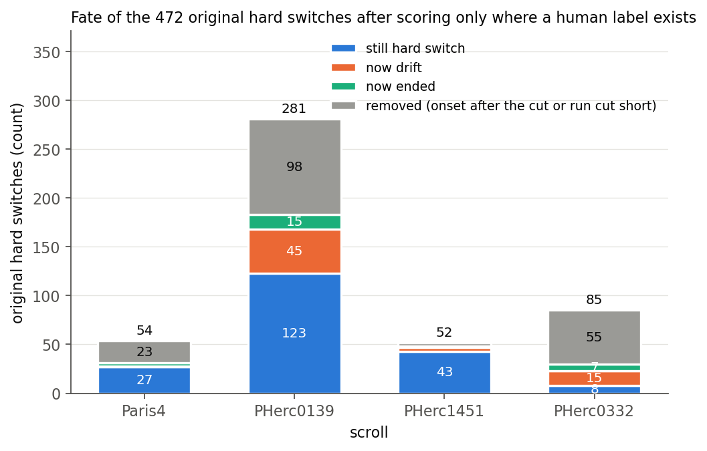
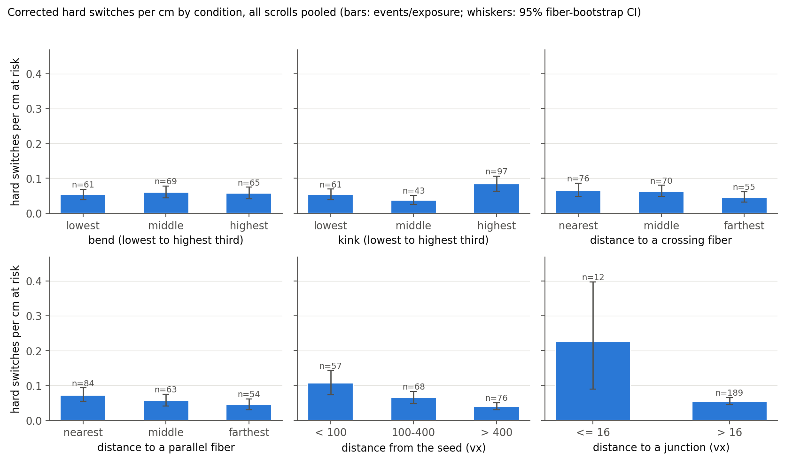

# Full report: held-out evaluation of fiber_single_small on PHerc0139, PHerc1451 and PHerc0332

Short version: [README.md](README.md).

**Definitions used in the README table.**
- *Within 1.5 vx*: villa's `geometric_outcomes` agreement length over the trace length that has a human label (up to the
  annotation end), `code/villa_metrics.py`, `results/v3/apples/summary_known.csv`. On Paris4 it matches the release notes'
  ~90%; their exact definition is not published.
- *Departure*: farther than 3 vx from the annotation for at least 3 vx of path (villa `score_trace`).
- *Real jump (hard switch)*: a departure that never returns and peaks > 15 vx away, excluding traces that only ran past
  an untagged annotation end (v3 section below).
- *Strict precision with PR #2143*: `code/rescore_pr2143.py`, `results/v3/rescore/summary.csv`.

The release notes for `scrollprize/fiber_single_small` (12 Oct 2026) say the model *"does make mistakes (though they
are relatively rare), and there is not currently an 'easy' way to tell when it does"*, and that with *"fwd/back
consistency [it] can trace almost entirely mistake free."*

I evaluated the model on annotated fibers from three scrolls that are not listed in its training metadata (PHerc0139,
PHerc1451, PHerc0332), with held-out Paris4 fibers as a comparison, using villa's own scorer. In these runs:

- **Departure rate.** The departure rate per cm on these three scrolls was **3.05 times** the rate on the held-out
  Paris4 fibers (95% CI 2.2–4.5).
- **Fwd/back vs confidence.** A simple forward/backward consistency check flagged **68%** of real hard switches,
  against **40%** for the model's confidence (McNemar p = 1e-7), with fewer false alarms per cm.
  - A hard switch is a departure that does not return to the fiber and peaks more than 15 vx (0.29 mm) away.
- **Where it fails.** It depends mostly on *which fiber*, not *which spot*: within the same fiber, bends, crossing
  fibers and nearby parallel fibers do not predict where it leaves. Real switches mostly slide sideways onto a fiber
  running the same way.

> **Correction (19 Oct 2026).** v2 reported 42% vs 32% and said the check failed on PHerc0332. That was wrong:
> 271 of the 472 "hard switches" were traces running past the end of the human annotation after an earlier small
> wobble, not jumps (on PHerc0332, 77 of 85). The v3 re-analysis below explains it. The 3.05× departure headline is
> unchanged (3.04×). The v2 tables are kept as published, with notes.

**Author's note.** When the fiber tracer was released, I wanted to see how it performs on scrolls outside its training
data, since that is where it will likely be used most. The release notes also mention that identifying tracing errors
is not straightforward. I tested it on all available annotated fibers from PHerc0139, PHerc1451, and PHerc0332, and
evaluated a simple version of the forward/backward consistency check described in the notes.

The check outperforms the confidence score on three of the four scrolls tested. On PHerc0332 it first seemed to make
no difference; the v3 re-analysis showed that most of the 0332 "switches" were a scoring artifact. I fixed the analysis plan before running the main experiments to avoid tuning it to
the results. Total GPU cost was about $13.

I used Claude Code as a coding assistant, but the research questions and decisions were mine, as is responsibility for
any mistakes. Feedback and corrections are welcome.

How it was done:

- **Traces.** 2,752 traces cover every annotated fiber of the three scrolls, plus 496 traces on 62 Paris4 fibers,
  seeded at 2–4 positions per fiber in both directions.
- **Settings.** The checkpoint ran at confidence 0.5, villa's CLI default for this model, and was scored with villa's
  own scorer.
- **Pre-registration.** The analysis plan (`ANALYSIS_PLAN_v2.md`) and the detector thresholds were fixed on a smaller
  pilot run. Their sha256 was recorded (`results/v2/plan_hash.txt`) before the main run started.
- **Checks.** All numbers were re-run and checked against villa's code and against a second, independent
  implementation (`results/verification/VERIFICATION.md`).

Brackets are 95% CIs from a bootstrap that resamples whole fibers.

## Results

### 1. Departure rates by scroll

| conf 0.5 | Paris4 (held out) | PHerc0139 | PHerc1451 | PHerc0332 |
|---|---|---|---|---|
| traces / fibers | 496 / 62 | 1608 / 402 | 576 / 72 | 568 / 71 |
| strict length precision (villa) | 0.80 [0.73, 0.86] | 0.58 [0.54, 0.62] | 0.78 [0.71, 0.84] | 0.59 [0.47, 0.71] |
| strict precision, length past the annotation end = unknown (villa PR #2143) | 0.82 | 0.64 | 0.78 | 0.77 |
| pointwise length precision | 0.92 | 0.77 | 0.87 | 0.72 |
| length-weighted coverage | 0.38 | 0.25 | 0.22 | 0.33 |
| departures per cm of correct tracing | 0.155 [0.11, 0.21] | 0.55 [0.48, 0.62] | 0.29 [0.22, 0.39] | 0.47 [0.31, 0.67] |
| departures per 100 decisions | 0.20 | 0.64 | 0.40 | 0.31 |
| hard switches per cm | 0.060 | 0.168 | 0.095 | 0.237 |

- **Departures.** On the three scrolls pooled, departures per cm are **3.05×** the Paris4 rate (fiber bootstrap
  [2.17, 4.46]; exact test p < 1e-4). Each scroll is higher on its own: 3.5×, 1.9× and 3.0×, all p < 0.001.
- **Hard switches.** Hard switches (no return, peak > 15 vx) are 2.7× as frequent per cm [2.0, 3.6]. *Correction:
  after removing the past-the-end artifact (v3), real hard switches per cm are 0.030 / 0.073 / 0.079 / 0.022, and
  unseen vs Paris4 is 2.2× [1.3, 4.4]. PHerc0332 is not worse than Paris4 (0.74×, 8 switches).*


### 2. Forward/backward check vs confidence on hard switches

The check runs every 128 vx of a finished trace. It traces back 192 vx from that point and flags the stretch if any
back-trace point lies more than 3 vx from the forward path. The confidence flag fires if the gating confidence (the
16th-point running minimum the tracer itself uses) drops below 0.566 in the same stretch. Both thresholds were frozen
on the pilot run. A departure counts as caught if a check within 192 vx after it flags.

*Correction (v3): this table includes the past-the-end artifact. On real hard switches only:*

| Real hard switches caught (v3) | Paris4 | 0139 | 1451 | 0332 | 3 scrolls pooled |
|---|---|---|---|---|---|
| n | 27 | 118 | 41 | 8 | 167 |
| fwd/back | 70% | 67% | 76% | 3 of 8 | **68%** |
| confidence | 15% | 38% | 46% | 3 of 8 | **40%** |
| McNemar p | 3e-4 | 1e-6 | 0.02 | 1.0 | 1e-7 |

The original v2 table:

| Hard switches caught | Paris4 | 0139 | 1451 | 0332 | 3 scrolls pooled |
|---|---|---|---|---|---|
| n | 51 | 271 | 48 | 75 | 394 |
| fwd/back | 47% | 45% | 75% | 12% | **42%** [36, 49] |
| confidence | 20% | 33% | 46% | 17% | **32%** [27, 37] |
| difference, fiber-level 95% CI | +27 [+6, +47] | +12 [+4, +19] | +29 [+6, +51] | −5 [−14, +3] | +11 [+4, +17] |
| fiber-level p (cluster sign-flip) | 0.045 | 0.004 | 0.035 | 0.37 | 0.002 |
| combined: logistic model of both signals, frozen on the pilot (more false alarms, below) | 59% | 66% | 92% | 44% | 65% |

| False alarms per cm of on-fiber path | Paris4 | 0139 | 1451 | 0332 |
|---|---|---|---|---|
| fwd/back | 0.023 | 0.077 | 0.081 | 0.088 |
| confidence | 0.17 | 0.30 | 0.44 | 0.36 |
| combined | 0.18 | 0.45 | 0.60 | 0.55 |

- **Test unit.** Several hard switches can come from the same fiber, so the tests and CIs treat the fiber as the
  unit (`code/cluster_test.py`). The pre-registered per-event McNemar test gives the same direction (pooled p < 0.001).
- **False alarms.** In these runs fwd/back raised fewer false alarms per cm than confidence on all four sets.
- **0332.** On PHerc0332 it flagged fewer hard switches than confidence (v2). v3: 77 of those 85 were the
  past-the-end artifact; on the 8 real ones both catch 3.
- **Returned excursions.** For small excursions that come back, confidence catches more than fwd/back (22% vs 16%,
  three scrolls pooled).
- **Unchecked departures.** 232 of 1,930 departures had no check within 192 vx (trace ended), so they are left out of
  both detectors' counts.


### 3. Trimming at the first failed check (secondary)

The pre-specified rule: a check fails if less than 90% of the back trace is within 3 vx of the forward path, or if the
back trace covers less than half the window. The trace is then cut back to the previous passing check. It is compared
with confidence stopping at a threshold that keeps the same correct length.

| Wrong length removed vs confidence, same correct length | Paris4 | 0139 | 1451 | 0332 |
|---|---|---|---|---|
| strict (villa) | 22% [3, 38] | 13% [2, 23] | 25% [−2, 53] | −5% [−41, 13] |
| pointwise | 51% [19, 70] | 36% [26, 46] | 64% [31, 79] | −1% [−35, 20] |

- **Full round trip.** Tracing back from the end of the whole trace and keeping it only if the back trace returns to
  the seed is *worse* than confidence on 0139 and 0332 (strict −136% and −125%).
- **Cost.** In the pilot, the segmented check added about 1.3–1.4× tracing.

Note: strict wrong length here also counts trace length past the annotation end after a departure, which should be
unknown (villa PR #2143). With that fix, strict precision is 0.82 / 0.64 / 0.78 / 0.77 (`results/v3/rescore/`); this
trimming comparison was not re-run with it.

Exploratory, not in the plan: simple CT measurements at switch points (layer spacing, in-sheet fiber spacing,
contrast) did not differ from on-fiber controls (`results/v2/image_features*.csv`).

## Pilot run (v1, exploratory)

323 traces, one seed per fiber (villa's `validation_manifest`), at confidence 0.5 and 0.7. Results: `results/final/`.

- **Confidence 0.7.** It raised strict precision to 0.86–0.90 mostly by stopping earlier: coverage fell by 29–42%, and
  the departure rate per cm changed little (ratio 0.76, p = 0.14).
- **Returned excursions.** About 60% of the scorer's departures were small excursions that came back, with a median
  peak of 3.5–4.2 vx.
- **Visual audit.** The 24 hard switches were checked by eye in 2-D views. 8 look like tracer errors, mostly jumps to a
  neighbouring fiber in the same sheet. 4 look like annotation problems, and 12 are layer forks or unclear. This is
  one person's reading and has not been checked by annotators. Coordinates are in
  `results/final/visual_audit_hard_switches.csv`.
- **Superseded estimates.** The pilot's larger stop-rule gains and its 71% catch rate were measured on a small subset.
  The v2 numbers above replace them.

## Setup

| | |
|---|---|
| Model | `scrollprize/fiber_single_small`, HF revision `451182558cb3270cfc2ddf967acbd4f36b9b816b` (step 50000) |
| Code | ScrollPrize/villa `ccb431818fa68059138f2c964ae299fc474ff116`. The tracer and scorer are used unchanged; this repo adds wrapper scripts only. |
| Policy | Confidence 0.5. The rest comes from the checkpoint: n_commit 8, full gate, recovery distance 6, 3 refinement steps. Max 2000 vx per direction. |
| CT | ESRF 2.4 µm, 78 keV masked volumes (open-data S3), level 2. 1 trace voxel = 19.2 µm. |
| Ground truth | Human VC3D fibers from HF `scrollprize/datasets` `spiral/<scroll>/fibers`. Paris4: the first 62 of `eval_fibers` in the trainer's `fiber_hash` order (seed 7349). |
| Seeds | villa's `make_seeds` on every loadable fiber: 4 positions × 2 directions (Paris4, 1451, 0332), 2 × 2 (0139). It returned no seed for 7 fibers on 0139 and 6 on 0332. |
| Scoring | **Strict:** villa `score_trace` (tolerance 3 vx, patience 3 vx; everything after the first departure is wrong). **Pointwise:** a segment is wrong only while it is more than 3 vx from the matched GT. **Hard switch:** a departure that never comes back (≥ 16 vx within 3 vx) and peaks above 15 vx. |

## v3: where and why it leaves the fiber (19 Oct 2026)

Plan: `ANALYSIS_PLAN_v3.md`, sha256 in `results/v3/plan_hash.txt`, fixed before any v3 number. Same saved v2 traces,
CPU only, nothing re-traced. Code: `code/why_errors.py`, `code/why_tests.py`, `code/why_figures.py`.

**What went wrong in v2.** Human annotation often stops before the real fiber does. If a trace had a small excursion
that came back, and later ran past the untagged annotation end, villa's scorer did not apply its end-of-annotation
check to that later stretch, and our v2 classification called it a hard switch. Post-hoc fix (chosen after seeing the
data, so labelled post-hoc): score only up to where the trace crosses the annotation end (villa `endpoint_crossing`,
same reach as `score_trace`). 472 hard switches → 201 real, 180 removed, 91 become drift or ended.



**Pre-registered tests (Holm over 5, on the original episodes).**

| | estimate [95% CI] | Holm p |
|---|---|---|
| Q1 same place in both directions (OR) | 11 [0, ∞], 7 shared bins | 0.94 |
| Q2 sharp bend, top vs bottom tertile | 0.95 [0.65, 1.38] | 1.0 |
| Q3 crossing fiber near | **2.0 [1.5, 2.8]** | **0.001** |
| Q4 parallel fiber near | 1.19 [0.88, 1.67] | 0.94 |
| Q5 family V vs H | 0.91 [0.68, 1.20] | 1.0 |

Q3 passed, but mostly from the artifact: on real switches it is 1.4× [0.9, 2.2].

**Real switches, across the scroll vs within the same fiber (post-hoc).**

| condition | across scroll | within the same fiber |
|---|---|---|
| sharp bend | 1.07 [0.72, 1.56] | 1.04 [0.68, 1.56] |
| crossing fiber near | 1.43 [0.94, 2.18] | 1.15 [0.70, 1.88] |
| parallel fiber near | 1.63 [1.09, 2.58] | 1.05 [0.50, 2.73] |
| rough annotation (kink) | 1.59 [1.08, 2.33] | 1.23 [0.83, 1.83] |
| within 16 vx of an annotated junction | 3.2 [1.2, 5.8] | 1.6 [0.6, 3.4] |
| > 400 vx vs < 100 vx from the seed | 0.38 [0.26, 0.58] | 1.34 [0.84, 2.32] |

Effects that look real across a scroll mostly vanish within a fiber. "Near the seed is risky" reverses: hard fibers
end traces early. So the risk is mostly per fiber, not per spot.

**What a real switch looks like (S6, 201 switches).** 16% land on another annotated fiber; all of those are the same
family, 27 of 33 are the nearest one, median gap 3.6 vx (70 µm). Turn angle is under 45° for 92%. Of switches that
were a trace's first departure, half go to the next layer and half stay in the sheet.

**Geometry does not explain the unseen-scroll gap (S1).** Strict departures per cm, unseen vs Paris4: crude 3.04×,
adjusted for bend, kink, family, seed and end distance 2.62× [1.92, 3.74].



Caveats: only annotated fibers count as neighbours; PHerc0332 has much denser control points; the Paris4 directory has
645 fibers but 62 were evaluated.

## Limits and what is not established

- **What makes some fibers hard.** Not established. Local geometry does not explain it, and simple CT features (v2)
  did not either.
- **Whether fwd/back helps at other settings.** Not tested: other confidence thresholds, check spacings, or other
  checkpoints.

- **Paris4 control.** Training used a hash split over fibers outside a legacy reserved list that is not public. From
  the checkpoint's own counts, 55 of the 62 Paris4 fibers are held out for certain, and the other 7 very likely.
  Results on the 55 alone are the same: ratio 3.11×, fwd/back 48% vs confidence 20%. The model also trained on
  automated fibers of the same Paris4 scan, so Paris4 is a same-scroll comparison.
- **Fwd/back implementation.** The check is this repo's own implementation (`code/fwdback.py`). It is not the procedure
  mentioned in the release notes.
- **Release-note metrics.** "90% of fiber length within 1.5 vx" and "leaves a fiber less than 1% of the time" were not
  computed here, because their exact definitions are not known.
- **Ground truth.** The ground truth is mostly unreviewed. The tolerance of 3 vx (58 µm) is tight relative to
  annotation noise.
- **PHerc0332 coordinates.** These fiber files carry no coordinate-space field. They fit the only public 0332 volume,
  which was used.
- **Stop rules.** They are simulated offline by cutting finished traces. The confidence curve is exact for thresholds
  ≥ 0.5.
- **Rounding ties.** 9 traces have a rounding tie at exactly 3.000 vx; villa's stored departure index is used for them.

## Reproduce

**GPU part.** About 5 h on one RunPod RTX 5090. Most of it was CT download. Per source, `runs/v2/pod/run_v2.sh`
runs the first four steps; `analyze.py` was run after it:

```bash
python code/fetch_fibers.py fibers/
python code/heldout_eval.py --name PHerc1451 --fibers fibers/PHerc1451 --ct <CT URL> --out runs/v2/PHerc1451 --per-fiber 4 --manifest-only
python code/heldout_eval.py --name PHerc1451 --fibers fibers/PHerc1451 --ct <CT URL> --out runs/v2/PHerc1451 \
       --per-fiber 4 --manifest runs/v2/PHerc1451/manifest.json --batch 128 --log-decisions
python code/fwdback.py --run runs/v2/PHerc1451 --batch 256
python code/image_features.py --run runs/v2/PHerc1451 --out runs/v2/PHerc1451/img
python code/analyze.py runs/v2/PHerc1451 --out runs/v2/PHerc1451/analysis
# Paris4: --heldout-hash 62 with fibers/paris4_eval; 0139: --per-fiber 2. CT URLs: code/sources.sh
```

**CPU part.** No villa import; a few minutes on a laptop.

```bash
python code/confirm_v2.py            # results/v2/ (reads results/v2/decisions.csv.gz = the four analysis/decisions.csv.gz)
python code/verify_independent.py    # separate re-implementation of the headline numbers
python code/stats.py                 # pilot results -> results/final/
```

**v3 (CPU, about 1 h on 2 cores).** DATA = repo root with the release unpacked; FIBERS = `code/fetch_fibers.py`
output; VILLA = `vesuvius/src` of villa with PR #2143; OUT = output dir.

```bash
python -I code/why_errors.py DATA FIBERS VILLA OUT --checks --tables
python -I code/why_tests.py  DATA FIBERS VILLA OUT                 # pre-registered tests
python -I code/why_errors.py DATA FIBERS VILLA OUT --flags --crossdiag
python -I code/why_tests.py  DATA FIBERS VILLA OUT --2c
python -I code/why_errors.py DATA FIBERS VILLA OUT --corrected
python -I code/why_tests.py  DATA FIBERS VILLA OUT --2d
python -I code/why_errors.py DATA FIBERS VILLA OUT --s6
python -I code/why_tests.py  DATA FIBERS VILLA OUT --2e
python code/why_figures.py results/v3 results/v3/figures
```

## Files

| Path | Contents |
|---|---|
| `ANALYSIS_PLAN_v2.md`, `results/v2/plan_hash.txt` | the plan and its hash, recorded before the run |
| `runs/v2/<source>/` | `rows.csv` (villa scores per trace), `paths.jsonl` (paths and GT distance profiles), `fwdback_*.csv`, `manifest.json`, `config.json`, `img/` (CT features and renders) |
| `results/v2/` | confirmatory tables (`summary_ci`, `rate_tests`, `detection_*`, `stop_rules*`, `image_feature*`), figures, `confirm_stdout.txt` |
| `results/verification/` | checks against villa, independent re-implementation, Paris4 split check |
| `results/v2/examples/` | example renders of hard switches (green: annotated fiber, red: trace, blue: other annotated fibers) |
| `results/v3/rescore/` | every trace re-scored with villa's scorer before and after PR #2143 |
| `ANALYSIS_PLAN_v3.md`, `results/v3/` | v3 plan, tables (`primary_tests`, `detection_recheck`, `hard_per_cm`, `fiber_stratified`, `s6_summary`, ...), figures |
| `results/final/`, `runs/c050`, `runs/c070` | pilot run |

## Data

The raw traces (`paths.jsonl`) and the per-decision tables are in the release archive `fiber_eval_data.tar.gz` (118
MB, sha256 `3215b1ae66b4a7dd1047af8077cfc8c7a75687356c6ffd75889a5e2333386540`). Unpack it in the repo root to re-run every number on CPU. CT and fibers come from the public sources listed under
Setup.

## Credits

Modar Ibrahim (@modaribrahim): study design, experimental decisions and interpretation. Claude Code (Anthropic) was
used as a coding assistant for implementation, running the experiments and analysis. I take responsibility for the
methodology and the reported results. Model, tracer and scorer: the Vesuvius Challenge
team (`scrollprize/fiber_single_small`, ScrollPrize/villa). Fiber annotations: the annotation team.

License: MIT for code, tables and figures.
